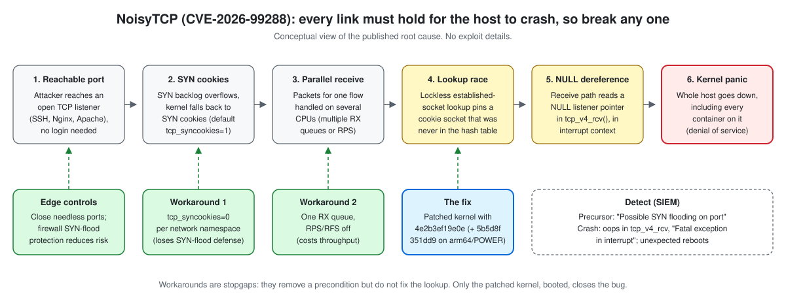
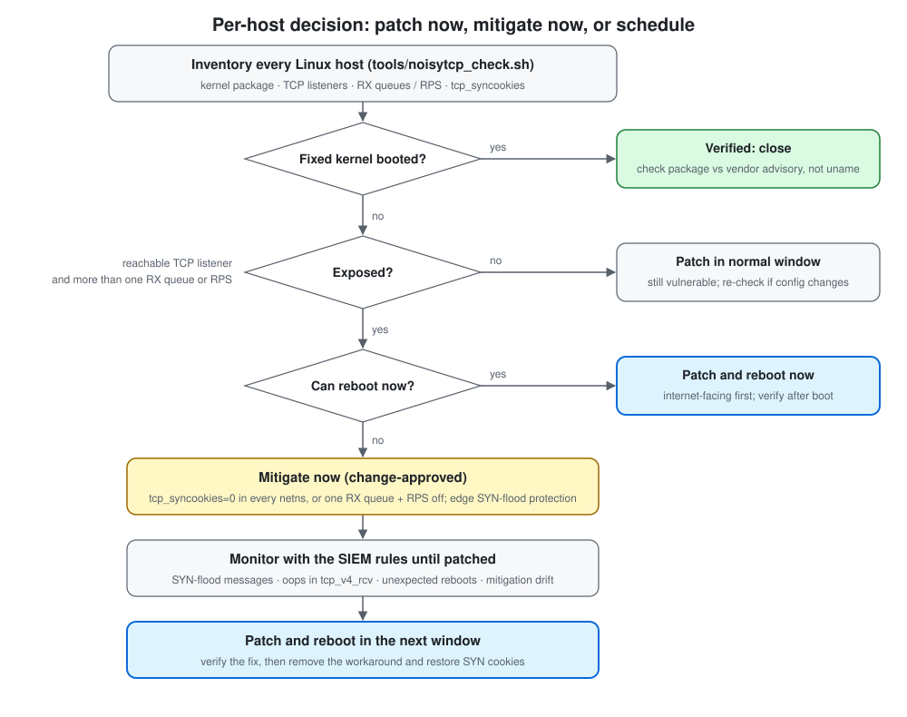
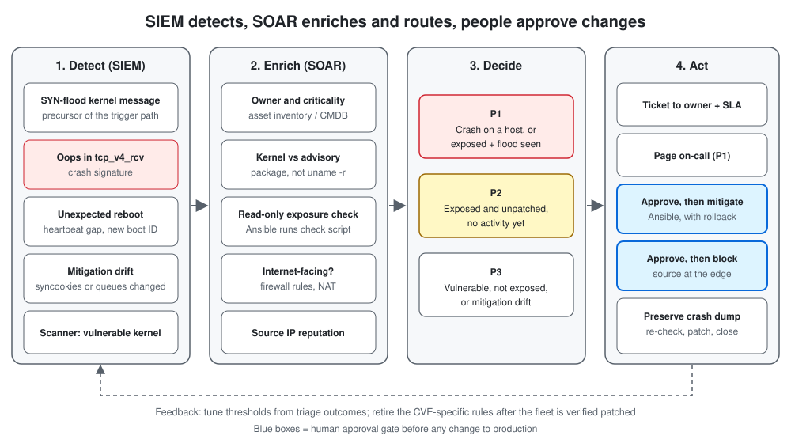

# Blue Team Playbook: NoisyTCP (CVE-2026-99288) on Linux

**Goal:** no Linux host can be crashed remotely through NoisyTCP. Get every exposed host onto a fixed kernel, protect the ones that cannot reboot yet, and detect attempts and crashes while you work.



| Phase | Outcome | Time target (internet-facing) |
|---|---|---|
| 1. Prepare | Logs, inventory and tooling ready | Before the next CVE |
| 2. Scope | Every Linux host classified FIXED / EXPOSED / MITIGATED / NOT_EXPOSED / UNKNOWN | Day 0 |
| 3. Protect | Exposed hosts patched or mitigated | 24–72 h |
| 4. Detect | SIEM rules live, SOAR routing alerts | Day 1 |
| 5. Respond | Crashes and floods handled with evidence | On alert |
| 6. Recover and close | Fixed kernel verified, workarounds removed | Per policy |
| 7. Review | Lessons fed back into policy and rules | Within 5 business days |

---

## Phase 1 — Prepare

- [ ] Collect **kernel logs** (facility `kern`) from all Linux hosts into the SIEM.
- [ ] Capture **panic messages** that never reach disk: netconsole, a serial console server, pstore (`/sys/fs/pstore`), or kdump with vmcore collection.
- [ ] Collect **auditd EXECVE** events so changes to `sysctl` and `ethtool` are visible.
- [ ] Keep a **Linux asset inventory** with owner, criticality, internet exposure and kernel package.
- [ ] Have **console access** (iLO/iDRAC, hypervisor console, cloud serial console) for hosts where you may change NIC queues.

## Phase 2 — Scope

The bug needs **all** of: a vulnerable kernel, a reachable TCP listener, and incoming traffic for one flow processed on more than one CPU (multiple RX queues or RPS). SYN cookies (the default) are on the demonstrated path.

1. Run the read-only check across the fleet:
   ```bash
   ansible-playbook -i inventory ansible/noisytcp.yml        # check mode by default
   # or on one host:
   sudo ./tools/noisytcp_check.sh --text
   ```
2. Confirm the fix with the **vendor**, not the version number:

   | Distribution (status as of 16 Nov 2026) | Status |
   |---|---|
   | Upstream stable | Fixed in 6.12.117, 6.18.63, 7.3.4; no fix yet for 6.6, 6.1, 5.x; 7.2 ended before the fix |
   | Debian 13 / 12 | Fixed: linux 6.12.117-1 (DSA-6628-1) / 6.1.192-1 (DLA-4906-1) |
   | Oracle Linux UEK 7–10 | Fixed: ELSA-2026-500630 to -500632 |
   | CIQ Rocky builds | Fixed 15 Nov |
   | RHEL 8/9/10, AlmaLinux, community Rocky, Oracle RHCK | Affected, fix pending |
   | Ubuntu | Under evaluation |
   | RHEL 6/7, CentOS 7 | Not affected |

   Re-check vendor trackers daily; this table will age quickly.
3. Prioritize: internet-facing → container and shared hosts → internal.



## Phase 3 — Protect

**Preferred:** install the vendor's fixed kernel and **reboot into it**. On arm64 and POWER, confirm the build also carries commit 5b5d8f351dd9.

**If you cannot reboot in time**, apply one workaround under an approved change (see `policy/PATCH-AND-MITIGATION-POLICY.md`):

| Workaround | Command (via Ansible) | Cost |
|---|---|---|
| 1. Disable SYN cookies | `-e noisytcp_mitigation=syncookies_off` | Loses SYN-flood protection; must be set in every network namespace; does not cover the second, harder variant |
| 2. Single RX queue, RPS/RFS off | `-e noisytcp_mitigation=single_queue -e noisytcp_iface=eth0` | Lower throughput; may briefly drop the link; not persistent across reboot |

**Defense in depth at the edge** (reduces, does not remove, risk):

- Close listeners that do not need to be public; restrict SSH to VPN or jump hosts.
- Enable SYN-flood protection on the perimeter firewall (e.g. Palo Alto Zone Protection with SYN cookies), so floods are absorbed before the host's backlog overflows. This matters most if you chose workaround 1.
- Rate-limit new connections per source at the edge or load balancer.

## Phase 4 — Detect

Deploy the rules in `detections/` (Sigma sources plus ready-made Sentinel KQL, Splunk SPL and Elastic queries):

| Rule | Signal | Severity |
|---|---|---|
| Kernel oops in `tcp_v4_rcv` | NULL pointer dereference in the TCP receive path, "Fatal exception in interrupt" | High |
| SYN backlog overflow | "Possible SYN flooding on port N. Sending cookies." — the precursor of the trigger path | Medium; High on unpatched hosts |
| Unexpected reboot | Heartbeat gap or new boot outside a change window | Medium |
| Mitigation drift | `sysctl` on `tcp_syncookies` / `rps_sock_flow_entries`, `ethtool -L` | Medium |
| Exposure status | `noisytcp_check.sh` result EXPOSED or UNKNOWN | Info / Medium |

How the SIEM and SOAR fit together:



The SOAR definition is in `soar/noisytcp_soar_workflow.yml`. Changes to production (mitigation, edge blocks) always pass a human approval gate.

## Phase 5 — Respond

**SYN-flood alert on an unpatched host (P1/P2):**
1. Confirm the host status with the check script.
2. Identify top sources from firewall or NetFlow logs for the alert window.
3. With approval, apply a workaround and block malicious sources at the edge for 24 h.
4. Patch and reboot as soon as possible.

**Host crashed (P1):**
1. Bring the host back (console reboot), but **first preserve** pstore contents, console or netconsole logs and any kdump vmcore.
2. Confirm the signature: oops in `tcp_v4_rcv`, NULL pointer dereference, "Fatal exception in interrupt".
3. If it matches, treat it as an attack on availability: apply a workaround before putting the host back in service, block sources at the edge, and patch.
4. Check sibling hosts behind the same service or load balancer; attackers usually hit them all.
5. Notify the owners of every container or VM on the host.

The public advisory reports denial of service only, with no demonstrated code execution and no in-the-wild exploitation as of 16 Nov 2026. A crash still warrants a normal compromise check if anything else looks wrong.

## Phase 6 — Recover and close

- [ ] Fixed kernel **booted** (check script returns `FIXED`).
- [ ] Workarounds rolled back: `-e noisytcp_mitigation=rollback`; SYN cookies back to 1; queues back to normal.
- [ ] Host removed from the `NoisyTCP_Unpatched` watchlist.
- [ ] Ticket closed with evidence.

## Phase 7 — Review

- Time from disclosure to first rule live, and to last exposed host fixed.
- Hosts where the kernel was patched but not rebooted.
- Data gaps found (missing kernel logs, panics not captured).
- CVE-specific rules: retire per `policy/SIEM-CONTENT-UPDATE-POLICY.md`; keep the generic ones.
