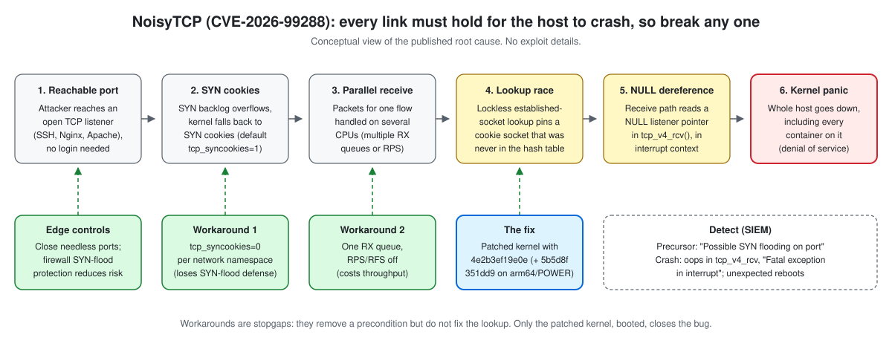
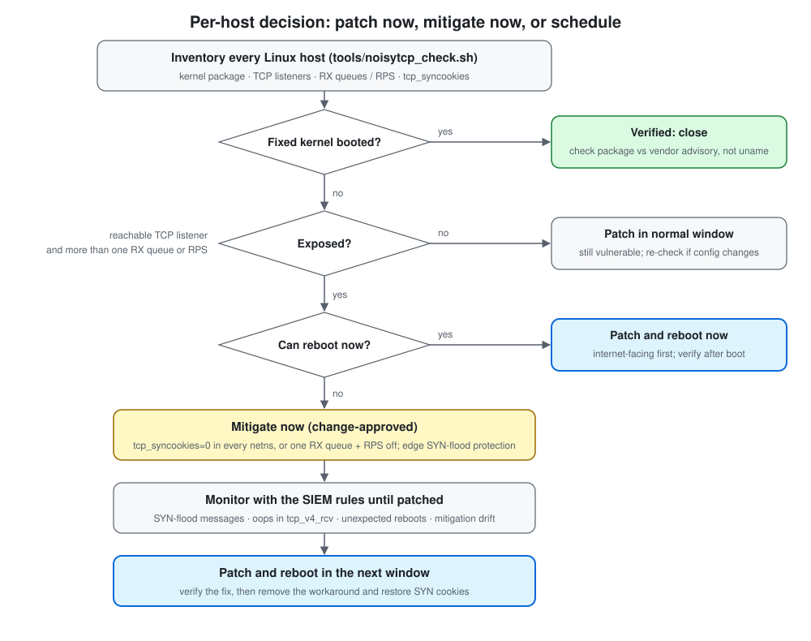
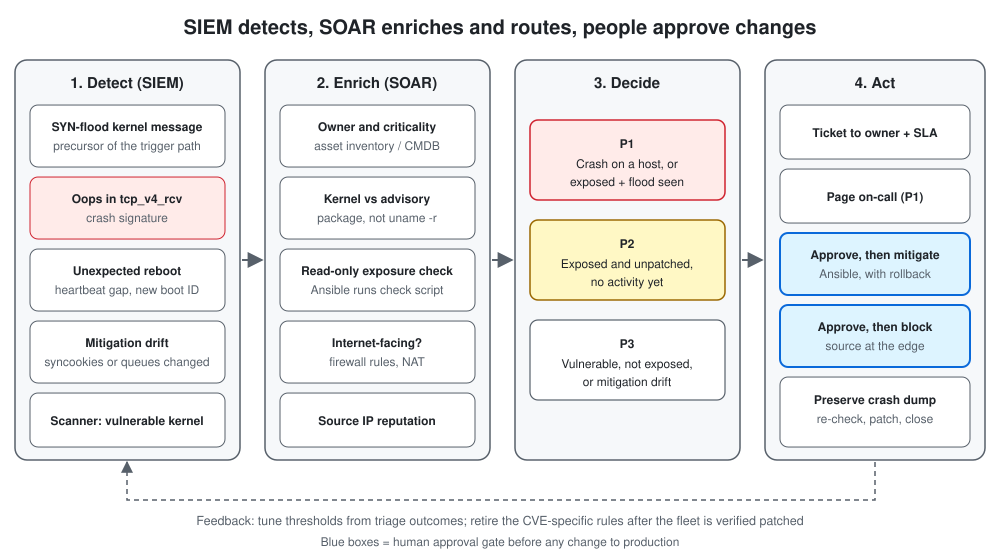

# NoisyTCP (CVE-2026-99288) Blue Team Playbook for Linux

> **Defensive resource.** No exploit code, no attack traffic. Facts are from public advisories and reporting as of 17 Nov 2026; check your distribution's tracker before acting. Not affiliated with any vendor; no employer data.

NoisyTCP is an 11-year-old race condition in the Linux kernel's TCP stack. An **unauthenticated remote attacker** who can reach an open TCP port can **panic the whole host**, including every container on it. SSH, Nginx and Apache are affected in default configurations.



## At a glance

| Item | Detail |
|---|---|
| CVE | CVE-2026-99288 ("NoisyTCP"), found by Hyunwoo Kim; public 15 Nov 2026 after the distro embargo |
| Component | Lockless TCP established-socket lookup; SYN-cookie request sockets can be pinned by a concurrent lookup, leading to a NULL pointer dereference in `tcp_v4_rcv()` |
| Introduced | Commit 079096f103fa, October 2015 (Linux 4.4) |
| Impact | Remote denial of service (kernel panic). No general code execution demonstrated |
| Preconditions | Reachable TCP listener; one flow processed on more than one CPU (multiple RX queues or RPS); SYN cookies on the demonstrated path |
| Severity | Red Hat: Important, CVSS 7.5 (preliminary). TuxCare rescored 5.9 |
| Fix | Upstream commit 4e2b3ef19e0e (3 Nov 2026); stable 6.12.117, 6.18.63, 7.3.4. arm64/POWER also need 5b5d8f351dd9 |
| Not affected | RHEL 6, RHEL 7, CentOS 7 |
| In the wild | None reported as of 16 Nov 2026 |
| Workarounds | Disable SYN cookies, or single RX queue with RPS/RFS off. Both are stopgaps |

## What's in this repo

| Path | Purpose |
|---|---|
| [`PLAYBOOK.md`](PLAYBOOK.md) | The seven-phase blue-team playbook: prepare, scope, protect, detect, respond, recover, review |
| [`docs/images/`](docs/images) | Crash chain, per-host decision workflow, SIEM/SOAR flow (SVG) |
| [`tools/noisytcp_check.sh`](tools/noisytcp_check.sh) | Read-only host check; JSON output for SIEM ingestion |
| [`ansible/noisytcp.yml`](ansible/noisytcp.yml) | Fleet check, change-approved workarounds, and rollback |
| [`detections/sigma/`](detections/sigma) | Sigma rules: kernel oops in `tcp_v4_rcv`, SYN-flood precursor, mitigation drift |
| [`detections/sentinel-kql/`](detections/sentinel-kql) | Microsoft Sentinel analytics rules |
| [`detections/splunk-spl/`](detections/splunk-spl) | Splunk searches |
| [`detections/elastic/`](detections/elastic) | Elastic Security rules |
| [`soar/noisytcp_soar_workflow.yml`](soar/noisytcp_soar_workflow.yml) | Vendor-neutral SOAR workflow (maps to Tines, Sentinel playbooks, Splunk SOAR, XSOAR) with approval gates |
| [`policy/SIEM-CONTENT-UPDATE-POLICY.md`](policy/SIEM-CONTENT-UPDATE-POLICY.md) | How emergency detection content is created, tested, tuned and retired |
| [`policy/PATCH-AND-MITIGATION-POLICY.md`](policy/PATCH-AND-MITIGATION-POLICY.md) | Patch deadlines and workaround rules by host category |

## Workflows

| Per-host decision | SIEM → SOAR → people |
|---|---|
|  |  |

## Quick start

```bash
git clone https://github.com/donxud/NoisyTCP-Blue-Team-Playbook.git
cd NoisyTCP-Blue-Team-Playbook
sudo bash tools/noisytcp_check.sh --text              # one host, read-only
ansible-playbook -i <inventory> ansible/noisytcp.yml   # whole fleet, read-only
```

Statuses: `FIXED`, `NOT_EXPOSED` (no reachable listener, or a single RX queue with RPS off; still patch in the normal window), `MITIGATED` (SYN cookies turned off as a workaround; still needs the fix), `EXPOSED`, `UNKNOWN` (compare the package with your vendor advisory).

**Limitations:** the check reads the kernel changelog (Debian/Ubuntu, RHEL family) for the CVE ID. Vendors that do not record CVE IDs there will show `UNKNOWN`; confirm those manually. The detection rules are untested templates: validate field names and data sources in your SIEM before enabling them.

## References

- [The Register: NoisyTCP gives Linux servers a remote crash problem](https://www.theregister.com/security/2026/11/16/noisytcp-bug-gives-linux-servers-a-remote-crash-problem-11-years-in-the-making/5310144)
- [TuxCare: patch status, fixed kernels, mitigations and checks](https://tuxcare.com/blog/noisytcp-cve/)
- [The CyberSec Guru: root cause, crash signature, distro status](https://thecybersecguru.com/exploits/noisytcp-cve-2026-99288-linux-kernel-tcp-vulnerability/)
- [SOC Prime: CVE-2026-99288 overview](https://socprime.com/blog/cve-2026-99288-noisytcp-linux-kernel-flaw-enables-remote-server-crashes/)
- [Cybernews: Red Hat rating and recommended mitigations](https://cybernews.com/security/noisytcp-linux-kernel-vulnerability-crashes-servers/)
- Researcher advisory: GitHub `V4bel/NoisyTCP` and oss-security, 15 Nov 2026

## License

Code under the [MIT License](LICENSE). Vulnerability facts belong to their sources.
